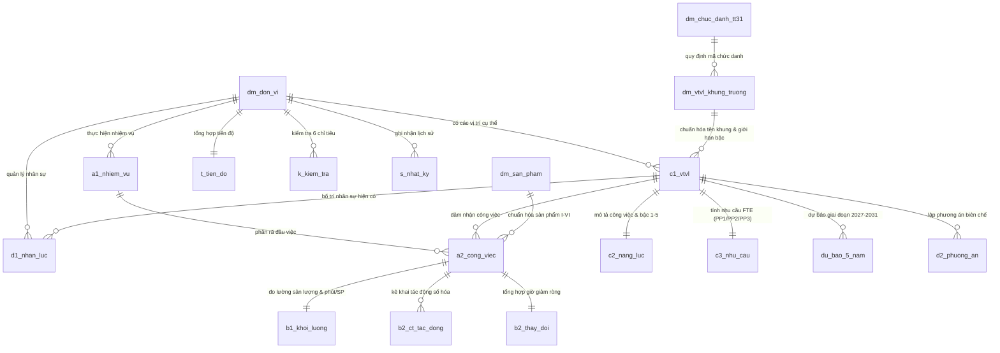

# Thiết kế Cơ sở dữ liệu quan hệ (Relational Database Schema — 18 bảng)

Tài liệu này mô tả kiến trúc **Cơ sở dữ liệu quan hệ (PostgreSQL / Supabase)** của hệ thống **HCM-UTE VTVL 360** dành cho **Trường Đại học Công nghệ Kỹ thuật TP.HCM (HCM-UTE)**, ánh xạ 1-1 với bộ 21 trang tính theo **Hướng dẫn số 07-HD/BTCTW**, **Nghị định số 232/2026/NĐ-CP**, **Thông tư số 31/2026/TT-BGDĐT** và **Hướng dẫn số 02 (`1907/HD-ĐHCNKT` ngày 17/6/2026 của Hiệu trưởng HCM-UTE)**.

Tệp SQL khởi tạo: [`20261107_init_vtvl_hcmute.sql`](file:///Users/macaz/Documents/0. App/VTVL /supabase/migrations/20261107_init_vtvl_hcmute.sql)

---

## 1. Sơ đồ quan hệ thực thể (Entity-Relationship Diagram — ERD)

---

## 2. Phân nhóm 18 bảng dữ liệu quan hệ

### Nhóm I — 04 bảng danh mục chuẩn cấp Trường & Bộ (`Master Catalogs`)
1. **`public.dm_don_vi`** (PK: `ma_don_vi`): Lưu trữ danh mục 51 đơn vị thuộc/trực thuộc HCM-UTE thuộc 04 khối (`khoa-vien`, `phong-ban`, `trung-tam`, `dang-doanthe`).
2. **`public.dm_chuc_danh_tt31`** (PK: `ma_so_chuc_danh`): Lưu trữ 28 mã số chức danh nghề nghiệp và hệ số lương nhà giáo theo Thông tư `31/2026/TT-BGDĐT` (gồm cả mã chuyển tiếp Trợ giảng `V.07.01.23` tại khoản 5 Điều 15).
3. **`public.dm_vtvl_khung_truong`** (PK: `ma_danh_muc_nd232`): Lưu trữ Khung 38 vị trí việc làm của Trường theo 04 nhóm (`I. Quản lý`, `II. Chuyên môn, nghiệp vụ`, `III. Hỗ trợ`, `IV. Phục vụ`), giới hạn bậc nghề nghiệp (`gioi_han_bac_nghe_nghiep`), mảng bậc cho phép (`ds_bac_cho_phep` kiểu `jsonb`) và công thức đặt Tên VTVL cụ thể (`cong_thuc_ten_cu_the`) theo Phụ lục I văn bản `1907/HD-ĐHCNKT`.
4. **`public.dm_san_pham`** (PK: `ma_sp_chuan`): Danh mục sản phẩm chuẩn 06 nhóm La Mã (`I`–`VI`, Biểu `11. DM_SAN_PHAM`) và định mức phút/sản phẩm chuẩn.

### Nhóm II — 14 bảng dữ liệu nghiệp vụ theo đơn vị (`Unit Operational Tables`)
5. **`public.c1_vtvl`** (PK: `ma_vtvl`, FK: `ma_don_vi`, `ma_danh_muc_nd232`): Danh mục VTVL cụ thể tại đơn vị (Biểu `6. C1_VTVL` & Phụ lục II `1907/HD-ĐHCNKT`), lưu trữ song song **Tên khung VTVL của Trường** (`ten_khung_vtvl_truong`), **Tên VTVL cụ thể tại đơn vị** (`ten_vtvl_cu_the_don_vi`), **Bậc nghề nghiệp sử dụng** (`bac_nghe_nghiep_su_dung`) và **Quỹ giờ chuẩn PP2** (`1.760` giờ đối với Giảng viên/Trợ giảng hoặc `1.904` giờ đối với Chế độ phổ biến).
6. **`public.a1_nhiem_vu`** (PK: `ma_nhiem_vu`, FK: `ma_don_vi`): Danh mục nhiệm vụ của đơn vị (Biểu `1. A1_NhiemVu`).
7. **`public.a2_cong_viec`** (PK: `ma_cong_viec`, FK: `ma_don_vi`, `ma_nhiem_vu`, `ma_vtvl`, `ma_sp_chuan`): Danh mục công việc và sản phẩm đầu ra (Biểu `2. A2_CongViec`).
8. **`public.b1_khoi_luong`** (PK: `ma_cong_viec`, FK: `ma_don_vi`, `ma_vtvl`, `ma_sp_chuan`): Thống kê sản lượng và thời gian thực tế 19 cột A–S (Biểu `3. B1_KhoiLuong`).
9. **`public.b2_ct_tac_dong`** (PK: `id_tac_dong`, FK: `ma_don_vi`, `ma_cong_viec`, `ma_vtvl`): Chi tiết tác động chuyển đổi số, tự chủ, thuê dịch vụ (Biểu `4. B2_CT_TacDong`).
10. **`public.b2_thay_doi`** (PK: `ma_cong_viec`, FK: `ma_don_vi`, `ma_vtvl`): Tổng hợp giờ giảm ròng theo đầu việc (Biểu `5. B2_ThayDoi`).
11. **`public.c2_nang_luc`** (PK: `ma_vtvl`, FK: `ma_don_vi`): Bản mô tả công việc và khung năng lực Bậc 1–5 (Biểu `7. C2_NangLuc`).
12. **`public.c3_nhu_cau`** (PK: `ma_vtvl`, FK: `ma_don_vi`): Xác định nhu cầu nhân lực theo PP1, PP2, PP3 (Biểu `8. C3_NhuCau`).
13. **`public.d1_nhan_luc`** (PK: `ma_nguon_luc`, FK: `ma_don_vi`, `ma_vtvl`): Nguồn nhân lực hiện có chốt tại 30/9/2026 (Biểu `9. D1_NhanLuc`).
14. **`public.du_bao_5_nam`** (PK: `(ma_vtvl, nam_du_bao)`, FK: `ma_don_vi`): Dự báo thay đổi khối lượng công việc giai đoạn 2027–2031 (Biểu `DU_BAO_5_NAM`).
15. **`public.d2_phuong_an`** (PK: `(ma_vtvl, nam_phuong_an)`, FK: `ma_don_vi`): Phương án bố trí nhân sự giai đoạn 2027–2031 (Biểu `10. D2_PhuongAn`).
16. **`public.k_kiem_tra`** (PK: `(ma_don_vi, stt_chi_tieu)`): Kết quả kiểm soát chéo tự động 6 chỉ tiêu (Biểu `13. K_KiemTra`).
17. **`public.t_tien_do`** (PK: `ma_don_vi`): Tổng hợp tiến độ hoàn thiện bộ biểu của đơn vị (Biểu `14. T_TienDo`).
18. **`public.s_nhat_ky`** (PK: `id`): Nhật ký phiên bản và thao tác trực tuyến (Biểu `15. S_NhatKy`).

---

## 3. Ràng buộc toàn vẹn & Trigger kiểm soát Bậc nghề nghiệp

- **Trigger `trg_validate_c1_career_level` (`public.fn_validate_c1_career_level()`):** Tự động đối chiếu giá trị `bac_nghe_nghiep_su_dung` trong bảng `public.c1_vtvl` với mảng `ds_bac_cho_phep` của vị trí khung tương ứng trong `public.dm_vtvl_khung_truong`. Nếu đơn vị nhập bậc nằm ngoài giới hạn Phụ lục I văn bản `1907/HD-ĐHCNKT`, cơ sở dữ liệu sẽ từ chối bản ghi và trả về thông báo lỗi cụ thể.
- **View `public.v_tong_hop_vtvl_toan_truong`:** Kết nối `dm_don_vi` và `t_tien_do` để tổng hợp trạng thái nộp hồ sơ và tổng nhu cầu FTE của toàn bộ 51 đơn vị thuộc HCM-UTE.
