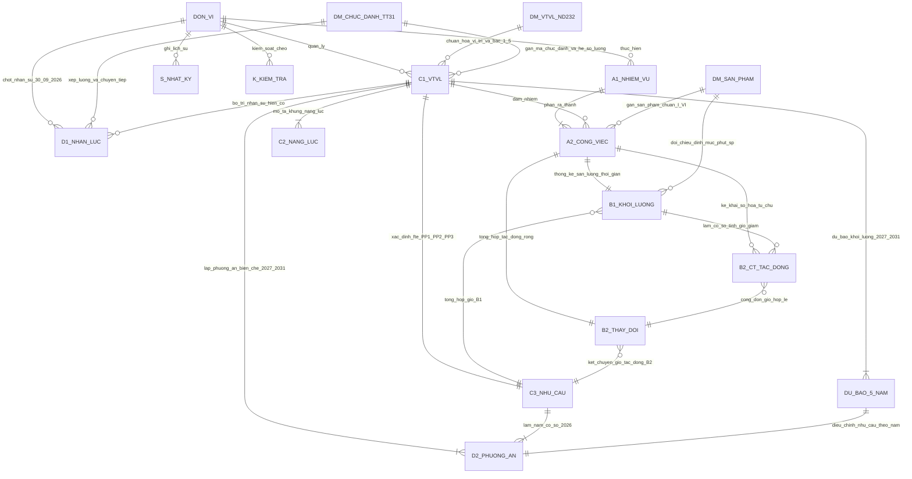

# Kiến trúc hệ thống Vị trí việc làm 360 — HCM-UTE (Chuẩn Hướng dẫn số 07-HD/BTCTW)

## 1. Bảo mật dữ liệu nội bộ (Zero Network Exposure)
- Toàn bộ tài liệu hướng dẫn gốc (`Tai lieu huong dan kem theo Huong dan so 07-HDVTVL/`) và kho kỹ năng (`20skill-van-phong-main/`) đã được khóa trong `.gitignore`, tuyệt đối không đẩy lên bất kỳ máy chủ hay kho lưu trữ từ xa nào.
- Mọi thao tác tách bộ biểu `.xlsx`, tạo gói `.zip`, đo bấm giờ, gộp phiếu và rà soát đều xử lý **100% cục bộ trên bộ nhớ trình duyệt (client-side)** bằng `xlsx` và `jszip`.

## 2. Quy trình 08 bước & Cấu trúc bộ biểu chuẩn 23 Sheet (Theo `01. HuongdanVTVL.docx`, `02-Bophuluc.docx` & `03. Bo bieu VTVL 25-10-2026.xlsx`)
- **Quy trình 08 bước nghiệp vụ (Bộ Phụ lục I–VIII):**
  1. **Bước 1:** Rà soát chức năng, nhiệm vụ và dữ liệu đã kê khai (`Phụ lục I, V` → `1. A1_NhiemVu`, đối chiếu `6. C1_VTVL`).
  2. **Bước 2:** Xác định công việc, công đoạn và sản phẩm đầu ra (`Phụ lục I, II, V` → `2. A2_CongViec`, `11. DM_SAN_PHAM`).
  3. **Bước 3:** Xác định số lượng sản phẩm và thời gian thực hiện (`Phụ lục III, IV, V` → `3. B1_KhoiLuong`).
  4. **Bước 4:** Xác định thay đổi công việc do chuyển đổi số, tự chủ, thuê dịch vụ (`Phụ lục III, IV, V` → `4. B2_CT_TacDong` → `5. B2_ThayDoi`).
  5. **Bước 5:** Đối chiếu danh mục VTVL, bản mô tả và khung năng lực (`Phụ lục II, V` → `6. C1_VTVL`, `7. C2_NangLuc`).
  6. **Bước 6:** Xác định số người cần thiết theo từng VTVL theo PP1, PP2, PP3 (`Phụ lục III, IV, V` → `8. C3_NhuCau`).
  7. **Bước 7:** Đối chiếu nguồn nhân lực hiện có (chốt `30/9/2026`) và lập phương án biên chế `2027–2031` (`Phụ lục III, IV, V` → `9. D1_NhanLuc`, `DU_BAO_5_NAM`, `10. D2_PhuongAn`).
  8. **Bước 8:** Kiểm tra chéo 10 biểu, xác nhận và gửi kết quả (`Phụ lục VI, VII, VIII` → `13. K_KiemTra`, `14. T_TienDo`, `15. S_NhatKy`).

- **Tệp đơn vị `[MÃ_ĐV]_K2526_v1_YYYYMMDD.xlsx` được khởi tạo gồm đúng 23 trang tính (bao gồm 10 biểu nghiệp vụ đánh số `1. A1` → `10. D2`):**
1. `HUONG_DAN` & `HD_DIEN_BIEU` (Thứ tự 12 bước nhập bảng; kỳ thống kê `01/10/2025–30/9/2026`; thời điểm chốt nhân lực `30/9/2026`; quỹ giờ chuẩn PP2 = `1.904 giờ/người/năm`; chế độ đặc thù Giảng viên/NCV = `1.760 giờ/người/năm`).
2. `1. A1_NhiemVu` (7 cột A–G)
3. `2. A2_CongViec` (8 cột A–H)
4. `3. B1_KhoiLuong` (19 cột A–S — tự động tra cứu `11. DM_SAN_PHAM`, tính `Giờ SP (tính)`, `Giờ tổng (tính)` và `Cảnh báo dữ liệu` ở cột R)
5. `4. B2_CT_TacDong` (19 cột A–S — chi tiết tác động số hóa, cải tiến quy trình, thuê dịch vụ, tự chủ, xã hội hóa)
6. `5. B2_ThayDoi` (9 cột A–I — tổng hợp giờ tác động ròng từ `B2_CT_TacDong`)
7. `6. C1_VTVL` (11 cột A–K — danh mục VTVL và kiểm tra quỹ giờ chuẩn PP2)
8. `7. C2_NangLuc` (7 cột A–G — bản mô tả công việc và khung năng lực)
9. `8. C3_NhuCau` (14 cột A–N — xác định nhu cầu nhân lực theo `PP1`, `PP2`, `PP3` và kết hợp)
10. `9. D1_NhanLuc` (11 cột A–K — nhân lực hiện có chốt tại `30/9/2026`)
11. `10. D2_PhuongAn` (14 cột A–N — phương án biên chế giai đoạn `2027–2031`)
12. `11. DM_SAN_PHAM` (10 cột A–J — danh mục sản phẩm chuẩn phân nhóm `I–VI`)
13. `12. CHIA_VUNG_CAP_XA`, `13. K_KiemTra` (6 chỉ tiêu kiểm soát tự động), `14. T_TienDo`, `15. S_NhatKy` (10 cột lịch sử phiên bản), `THAO_TAC_NHANH` (bảng tra nhanh quy trình 08 bước), `DM_06_NHOM`, `QUY_TAC_MA`, `DM_THAM_SO`, `DU_BAO_5_NAM` (10 cột A–J), `Can_cu_goi_y`.

## 3. Sơ đồ Thực thể – Liên kết (`erDiagram`) toàn hệ thống

